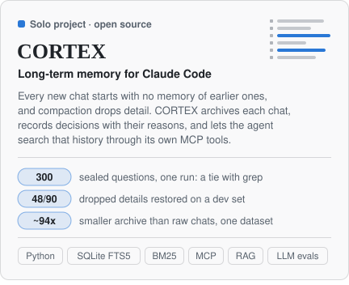
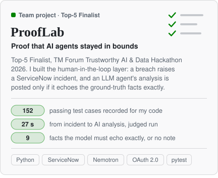
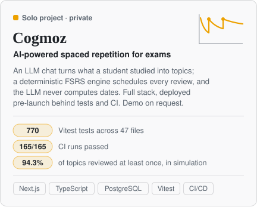
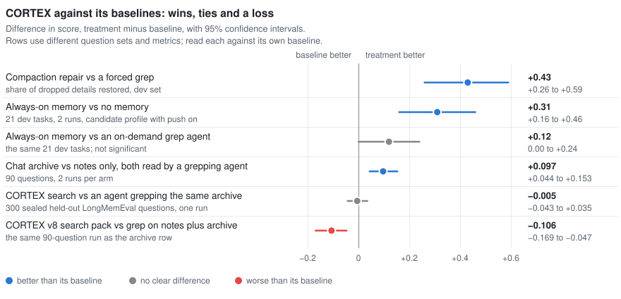
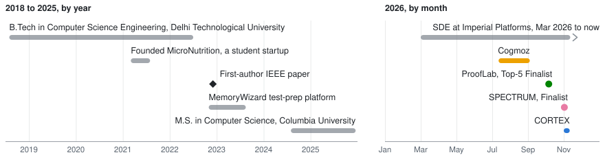

<picture>
  <source media="(prefers-color-scheme: dark)" srcset="assets/hero-dark.svg">
  <source media="(prefers-color-scheme: light)" srcset="assets/hero-light.svg">
  
</picture>

**I'm Arth Singh, a software engineer in New York (M.S. Computer Science, Columbia).** I build AI agents and the systems behind them: long-term memory and retrieval, multi-agent orchestration, LLM evaluation, and audit trails with human-in-the-loop approval. Underneath it is backend engineering in Python and TypeScript: APIs, data models, tests and CI/CD.

**Open to SDE and AI Engineer roles.** &nbsp; [][linkedin] [][email]

**Core areas:** LLM agents and agentic AI · multi-agent orchestration · retrieval-augmented generation (RAG) and information retrieval (BM25, rank fusion, opt-in hybrid search) · Model Context Protocol (MCP) and tool calling · context engineering · LLM evaluation · trustworthy AI (guardrails, human-in-the-loop approval, audit trails) · AI observability (agent token-spend, audit-log and latency-drift monitoring) · backend APIs, PostgreSQL and distributed-systems patterns

- **CORTEX gives Claude Code a long-term memory for each project,** and its MCP server is harness-agnostic. I benchmarked a candidate configuration on 300 sealed held-out questions (one run) and published the tie with grep next to the wins.
- **Two AI hackathon finals in 2026, both team projects.** Finalist, 30+ teams / 100+ participants, at AWS × FYUZ Breaking Barriers (Amazon Spheres, Seattle) with SPECTRUM, a governed multi-agent system whose architecture I designed, and Top-5 Finalist at the TM Forum Trustworthy AI & Data Hackathon with ProofLab.
- **Cogmoz, a full-stack AI study app, deployed (pre-launch) behind 770 tests and 165/165 passing CI runs.** Also: first author of an IEEE conference paper (ICAC3N 2022), and 1,000+ problems solved in C++: 620+ on Codeforces (110+ rated 1600-2100) and 380+ on LeetCode.

<picture>
  <source media="(prefers-color-scheme: dark)" srcset="assets/proof-dark.svg">
  <source media="(prefers-color-scheme: light)" srcset="assets/proof-light.svg">
  
</picture>

## Featured work

[<picture><source media="(prefers-color-scheme: dark)" srcset="assets/card-cortex-dark.svg"><source media="(prefers-color-scheme: light)" srcset="assets/card-cortex-light.svg"></picture>][cortex] [<picture><source media="(prefers-color-scheme: dark)" srcset="assets/card-spectrum-dark.svg"><source media="(prefers-color-scheme: light)" srcset="assets/card-spectrum-light.svg"></picture>][spectrum]
[<picture><source media="(prefers-color-scheme: dark)" srcset="assets/card-prooflab-dark.svg"><source media="(prefers-color-scheme: light)" srcset="assets/card-prooflab-light.svg"></picture>][prooflab] [<picture><source media="(prefers-color-scheme: dark)" srcset="assets/card-cogmoz-dark.svg"><source media="(prefers-color-scheme: light)" srcset="assets/card-cogmoz-light.svg"></picture>](#cogmoz)

Each card opens its repository. Team projects say so, with my own part stated separately from what the team measured. Cogmoz is private, so its card jumps to the write-up below.

### CORTEX

Solo project, Nov 2026. Python 3.9 standard library and SQLite FTS5. **[Repository][cortex]**

**The problem.** An AI coding agent forgets. Every new chat in a project starts with no memory of the earlier chats, and when a long session is compacted into a summary, much of the detail is lost. Decisions, rejected options and the reasons behind them disappear, and Claude Code deletes old transcripts after 30 days. Of 463 real developer prompts I analysed, 136 (29.4%) restated, corrected or enforced something that had already been established (this sizes the problem; it is not a CORTEX result).

**The solution.** CORTEX gives the agent a long-term memory for each project. It archives every chat before it is deleted, records decisions and rejected options with their reasons and sources, repairs the context after a compaction by re-injecting the specifics the summary dropped (context engineering with no model calls), and lets the agent search that history through its own MCP tools: retrieval-augmented generation (RAG) over the project's own past. Memory and search run locally on Python and SQLite with no separate cloud service (record capture uses background Claude Haiku calls through Claude Code).

It is built for Claude Code: handlers for 6 hook events do the capture and the compaction repair. The 6 memory tools sit behind a plain stdio MCP server (JSON-RPC 2.0), so that part is harness-agnostic: other MCP-compatible agent harnesses can call it. Claude Code is the only harness I have tested it with.

<picture>
  <source media="(prefers-color-scheme: dark)" srcset="assets/cortex-arch-dark.svg">
  <source media="(prefers-color-scheme: light)" srcset="assets/cortex-arch-light.svg">
  
</picture>

**The results.** CORTEX ships with a pre-registered evaluation suite that publishes wins and nulls. The main baseline is a strong one: an agent that greps the same history. The chart shows the headline comparisons, with the tie and the loss left in.

<picture>
  <source media="(prefers-color-scheme: dark)" srcset="assets/cortex-results-dark.svg">
  <source media="(prefers-color-scheme: light)" srcset="assets/cortex-results-light.svg">
  
</picture>

- **It recovers lost detail after a compaction.** On a dev set of real compactions, compaction repair restored 48 of 90 dropped details, against 9 of 90 for a forced grep (+0.43, 95% CI +0.26 to +0.59). This is measured at retrieval level; the effect on answers is untested.
- **The archive carries the gain.** Adding the chat archive raised held-out answer accuracy from 0.806 to 0.903 (+9.7 points, 95% CI +4.4 to +15.3; 90 questions, 2 runs per arm), measured with an agent grepping notes plus archive. This credits the archive, not CORTEX's search.
- **The headline is a tie.** On 300 sealed held-out LongMemEval questions (one run, candidate profile), CORTEX's search tied with an agent grepping the same archive (−0.005, 95% CI −0.043 to +0.035) while reading 51–82% more tool output. The shipped v9 default has not been tested on the sealed set. Together with replays of real prompts and an unprompted-task study, that evidence drove v9.0, an "evidence-pruned" release that made the per-message push, embeddings, graph re-rank and tuned profiles opt-in.

The numbers behind the chart

 

| Comparison | Measured on | Difference | 95% CI | Reading |
|---|---|---|---|---|
| Compaction repair vs a forced grep | Dev set of real compactions, share of dropped details restored (48 of 90 vs 9 of 90) | +0.43 | +0.26 to +0.59 | Better at retrieval; effect on answers untested |
| Always-on memory vs no memory | 21 dev tasks, 2 runs, candidate profile with push on | +0.31 | +0.16 to +0.46 | Better |
| Always-on memory vs an on-demand grep agent | The same 21 dev tasks | +0.12 | 0.00 to +0.24 | Not significant |
| Chat archive vs notes only, both read by a grepping agent | 90 questions, 2 runs per arm; held-out answer accuracy 0.806 to 0.903 | +0.097 | +0.044 to +0.153 | Better: +9.7 points of answer accuracy (95% CI +4.4 to +15.3). This credits the archive, not CORTEX's search |
| CORTEX search vs an agent grepping the same archive | 300 sealed held-out LongMemEval questions, one run, candidate profile | −0.005 | −0.043 to +0.035 | Tie |
| CORTEX v8 search pack vs grep on notes plus archive | The same 90-question run; the pack scored 0.797 | −0.106 | −0.169 to −0.047 | Worse |

Rows use different question sets and metrics, so each is read against its own baseline. The dev rows may have informed tuning. The sealed row is the blind test.

What I built

 

- **Core.** 25 files and about 6.3k lines of dependency-free Python 3.9 on SQLite FTS5, with a hand-written stdio JSON-RPC MCP server exposing 6 memory tools and handlers for 6 Claude Code hook events.
- **Retrieval.** A deterministic pipeline: FTS5 candidate generation, a custom BM25 (k1 1.4, b 0.5), reciprocal rank fusion of the question with agent-written rewordings, typed-record boosts, and answer packs with transcript-line pointers.
- **Archive.** A redacted, line-addressed chat archive (secrets and emails masked) that outlives Claude Code's 30-day transcript deletion at about 94x smaller than raw transcripts (2.3 MB vs 217 MB on one private dataset).
- **Compaction repair.** It diffs the conversation against Claude Code's compaction summary and re-injects the dropped specifics with line pointers, using no model calls.
- **Evaluation harness.** Pre-registered, 65 scripts and about 8.7k lines excluding report builders: isolated Claude Sonnet agent arms, blind LLM-written question sets, a Haiku ×3 per-fact judge (an audit found about 22% wrong verdicts on disputed items), paired-bootstrap 95% CIs, and a sealed LongMemEval evaluator with a blind sha1 test300/final100 split and a 5-look cap.
- **Harness bugs, disclosed.** I caught, disclosed and fixed (for later runs) four artefacts that would have biased conclusions: a baseline allowlist that cost grep a call on about 10–13% of questions, a replay parser that leaked tool output into 160 of 463 queries, an answer footer visible to the judge, and two arms that never received their treatment.

Two rules I kept: no adopted configuration may remove exact search over the raw archive, and the archive is excluded from git through `.git/info/exclude` rather than `.gitignore`, because Claude Code's grep honours `.gitignore` and one there hid the whole archive from the agent.

### SPECTRUM

Team project (Team Invences), Nov 2026. **[Repository][spectrum]** (a copy with full history and a 'Team & my role' note; original by my teammate Satyabrat Srikumar: [ss7172/AWS_Hackathon][spectrum-orig]).

**Finalist, 30+ teams / 100+ participants:** TIP × AWS Breaking Barriers Hackathon @ FYUZ 2026, a 48-hour build at the AWS Seattle office with the finals at the Amazon Spheres.

SPECTRUM is a governed multi-agent AI system for 5G radio-network operations. LLM agents on Amazon Bedrock diagnose faults on a network digital twin and propose fixes. Every tool call passes a Cedar default-deny policy, every change needs a person's approval bound to a hash of that change, and every reported number sits on an evidence chain a judge can re-check.

**My role.**

- **Architecture.** I designed SPECTRUM's architecture and end-to-end pipeline for a self-improving multi-agent swarm.
- **Operator console and audit ledger.** I built the operator console (a FastAPI backend, 4,255 lines of Python, and a React 19/TypeScript UI, 11,149 lines in 89 files) and its Ed25519-signed, SHA-256 hash-chained, Merkle-anchored audit ledger, with a signed human-approval workflow. The ledger became the core of our team's evidence chain: the team's evidence ledger reuses my ledger code, the independent checker verifies every evidence file against it, and 200 of 245 console files are still byte-identical on the final main.
- **The 48-hour build.** On one shared laptop, my teammate and I pair-built the agent orchestration (a lead agent and specialists on Amazon Bedrock, calling MCP tools through a policy gateway), the serverless tool layer (AWS Lambda and DynamoDB) in which each human-approved change is applied exactly once, the trust gate and the evaluation suites, and the reinforcement-learning, federated-learning and digital-twin work.

The console began as a demo over a simulation: no model was trained or called in it, while the signed ledger, the approval state machine and the default-deny policy were real. Because the team shared one laptop, the event commits carry my teammate's name.

What our team measured, in simulation

 

- Our team's four Amazon Bedrock LLM agents (a gpt-oss-120b lead and gpt-oss-20b specialists) coordinated over A2A. Every MCP tool call went through Amazon Bedrock AgentCore Gateway under Cedar default-deny policies, and every network change was bound to a person's approval of its exact SHA-256-hashed change and applied exactly once in one DynamoDB transaction.
- Our team's policy checkpoint refused 27/27 forbidden tool calls (including 4 prompt injections) and applied 14/14 changes only after a person approved.
- Our team's model trust gate caught a degraded forecaster in 20/20 evaluation runs. It also falsely paused 7/20 healthy runs, so pauses were recorded, not enforced, and a person kept the final call.
- Our team's LoRA-tuned 1.7B telecom LLM, trained on 2,367 synthetic twin-generated examples, scored 0.616 vs 0.231 for Bedrock gpt-oss-20b on 63 frozen network-fixing items. Safety rose from 0.097 to 0.851, still below the declared 0.95 bar.
- Our team's federated KPI forecaster (FedAvg across three simulated, non-IID operator silos) reached error 0.647 vs 0.781 for one operator's local model (significant) and vs 0.670 for another's (not significant). A pooled central model was 0.083 better, and we reported it.
- Every judged number sat on an evidence chain: targets declared in S3 before each SageMaker run, per-item records, and an independent five-part checker that shares no code with the writer.
- Not shown: self-improvement was a design goal and has no measured result. Lessons reached the lead agent's ticket but not the model that picks the fix.

All results come from simulated network twins, not a live network.

### ProofLab

Team project (team iFabric), Oct 2026. **[Repository][prooflab]** (a copy of the main history without the organisers' challenge folder; original: [ss7172/ProofLab][prooflab-orig]).

**Top-5 Finalist (35+ teams):** TM Forum Trustworthy AI & Data Hackathon 2026, "Agentic assurance: the quest for proof", hosted by AT&T in Dallas and presented at TM Forum Innovate Americas 2026.

ProofLab proves to an auditor that three collaborating telecom AI agents on Amazon Bedrock AgentCore stayed within declared limits on token spend, audit-log completeness and latency drift. A breach raises a ServiceNow incident, an LLM Assurance Agent analyses it, and only a passing re-test closes it.

**My part.** I built the human-in-the-loop layer, with guardrails that fail closed:

- A standard-library Python ServiceNow integration (OAuth 2.0 client credentials, Table API) that turns each control breach into an idempotent, read-back-verified incident for the accountable owner. It shipped byte-identical in the final submission.
- The LLM Assurance Agent's analyser. It asks NVIDIA Nemotron, only through TM Forum's governed model gateway, for an incident analysis and writes the note only if the model echoes 9 ground-truth facts exactly. In the judged run it posted its analysis 27 s after the incident was delivered. My analyser ran in our team's 4th AgentCore runtime, which a teammate bundled and deployed.
- 141 test functions (152 recorded passing cases) against a fake ServiceNow and a fake model gateway over real HTTP. The team's merge gate required byte-identity and exactly 152 passes on every merge.

More of my part, and what our team measured

 

- I encoded the assurance logic as deterministic code rather than model judgement: an agent-route rule, policy-alignment checks P1–P8 and output-validation checks V1–V6. Missing data reports "unknown", never "pass".
- I wrote the SHA-256 manifest tool (Python standard library) that sealed our team's final evidence pack: a hash and size for every file plus a verify mode, shipped inside the pack so judges can re-check it offline.
- I designed the ProofLab Evidence Console (11 views, 9 JSON data contracts, 58 judging criteria traced to screens) and wrote its 3,753-line contract schema. Our team implemented 8 of the views and adopted it as the judged dashboard.
- I integrated with a teammate's AWS build through versioned, SHA-256-manifested hand-off packages, coordinating two parallel Claude Code sessions through a shared status file. The team merged the code as-is.

Team results:

- Our team's ProofLab checked three collaborating AI agents (customer, IT, network) against three declared controls: an inline per-run token cap (≤25,000 tokens), 100% audit-log coverage with gaps ≤29 s, and a two-sided ±75% latency-drift band. Each threshold was frozen and S3-dated before the assessed runs, with one declared post-hoc change: the token cap moved from 20,000 to 25,000.
- In the judged run, a declared fault (one suppressed record) breached the audit-log control at 43/44 events, raised a ServiceNow incident, drew an AI analysis note 27 s after delivery, and was closed only by a passing re-test (45/45).
- Our team's inline token check refused 3 over-cap calls in the normal run, which finished at 22,271 of 25,000 tokens.

### Cogmoz

Solo project, Jul–Sep 2026. Private repository, so there is no link. **Demo on request.**

Cogmoz is an AI-powered spaced-repetition PWA for exam students. An LLM chat turns what a student studied (typed, spoken, or a whole syllabus) into validated topics, and a deterministic FSRS-based engine schedules daily reviews inside the student's time budget. The LLM never computes dates.

- **Full stack, deployed.** Next.js 16, React 19, TypeScript, Supabase Postgres and Drizzle: 60 API route modules (78 handlers), 18 pages and 31 Postgres tables, all with row-level security, shipped continuously to Vercel.
- **Tested.** 770 Vitest tests across 47 files (golden tests, seeded property tests, end-to-end simulation scenarios). A GitHub Actions gate runs typecheck, lint, test and build, and all 165 CI runs passed (165/165).
- **Simulation.** A closed-loop simulator runs synthetic students against the production scheduler. In simulation, reordering daily reviews raised the share of topics reviewed at least once from 60.5% to 94.3% at a 180-minute budget, with about 5% fewer reviews; the cost was fewer topics above 0.80 recall (467 to 419). The simulator checks the scheduler against FSRS's own memory model, not real students.

Engineering detail

 

- **Scheduling engine.** About 4.3k lines of pure TypeScript with an injected clock, combining FSRS memory modeling (ts-fsrs) with a constraint-based daily packer: priority by forgetting risk × exam urgency × difficulty, elasticity windows and budget-aware splitting into at most 4 parts.
- **Exam-readiness planner.** It forecasts each topic's exam-day recall, allocates review passes weakest-first and earliest-deadline-first, and finds the daily budget by bisection. In simulation on 400 random fixtures it produced 3.9× more exam-ready topics than the project's previous allocator for the same minutes.
- **LLM layer.** Provider-agnostic, on raw HTTP to OpenAI-compatible APIs (Fireworks primary, OpenAI fallback), with 9 zod-validated JSON task contracts and a repair retry. Failover triggers only on transport errors, and a stream fails over only before its first item, so no item is duplicated.
- **Streaming imports.** LLM-generated exam syllabi stream to the browser over SSE, with an incremental JSON extractor, truncation detection and up to 5 continuation passes.
- **Idempotent re-planning.** A single Postgres transaction claims (user, local day) by compare-and-set on a watermark, so concurrent triggers (cron, app open, a second device) become no-ops.
- **Billing, built but not live.** Razorpay subscriptions with timing-safe HMAC-SHA256 webhook verification, event-id idempotency and a partial unique index as the double-billing guard, verified with locally signed webhook replays.

## How I build

I build with AI coding agents and say so. 176 of Cogmoz's 228 commits carry Claude co-author trailers, CORTEX was built with Claude Code, and so were both hackathon repositories (531 of 569 SPECTRUM commits and 115 of 117 on ProofLab's main carry the same trailers). What I own is the spec, the architecture, the verification and the integration, so the system around the agents is built to catch what a fast agent gets wrong.

<picture>
  <source media="(prefers-color-scheme: dark)" srcset="assets/how-i-build-dark.svg">
  <source media="(prefers-color-scheme: light)" srcset="assets/how-i-build-light.svg">
  
</picture>

Each stage answers a specific failure. Contracts come first because parallel agents drift: on SPECTRUM one set of pydantic v2 models generated the JSON Schema and the TypeScript types, so each record type was defined once for both languages. Each workstream there owned its paths, and the merge gate failed closed on a broken type, test, headless-smoke route or Python/JS canonical-hash parity; a pre-push secret scan failed closed as well. Evaluation is pre-registered because a pass bar set after the result proves nothing: CORTEX fixed its bars and its sealed held-out split first, scored answers with a majority-of-3 per-fact LLM judge, audited that judge, and published the nulls with paired-bootstrap 95% CIs. SPECTRUM's and ProofLab's results were stored so that a judge could re-check them, and in CORTEX the data made the call: features that only tied a strong baseline, such as the always-on memory push, shipped opt-in.

The coloured tags name the project behind each practice. The SPECTRUM practices come from the 48-hour team build; the others are from my own code.

Stage by stage

 

- **Contracts first, because parallel agents drift.** On SPECTRUM one set of pydantic v2 models generated the JSON Schema and the TypeScript types, so each record type was defined once for Python and TypeScript. For ProofLab I wrote the 3,753-line contract schema first, and our team implemented 8 of the console's 11 views from it.
- **Owned paths, because agents in parallel overwrite each other.** On SPECTRUM each workstream owned its paths and a script failed any diff outside them; the parallel agent sessions ran in git worktrees. On ProofLab I coordinated two parallel Claude Code sessions through a shared status file and versioned, SHA-256-manifested hand-off packages.
- **A gate that fails closed, because "it type-checks" is not "it works".** On SPECTRUM the merge gate ran type-check, lint, build and tests. The audit ledger hashes canonical JSON, so a Python/JS canonical-hash parity check confirms that the Python backend and the JavaScript in the console hash a record to the same value. A headless-Chrome smoke over the console's routes catches a page that compiles but does not render, and the pre-push secret scan never prints what it matched. Cogmoz runs the same kinds of check in CI on every push to main and every pull request (typecheck, lint, test, build), with seeded property tests over the scheduler's invariants.
- **Pre-registered evaluation, because a pass bar set after the result proves nothing.** CORTEX fixed its pass bars and its sealed held-out split before the runs, scored answers with a majority-of-3 per-fact LLM judge, audited that judge (about 22% wrong verdicts on disputed items), and reported paired-bootstrap 95% CIs with the nulls included.
- **Evidence a judge could re-check.** SPECTRUM declared each target before its run and anchored results in a signed, hash-chained ledger. ProofLab's evidence pack is sealed with the SHA-256 manifest tool I wrote, which ships inside the pack with a verify mode.
- **The data makes the call.** In CORTEX the always-on memory push only matched an on-demand grep agent (+0.12, 95% CI 0.00 to +0.24) and missed its pre-registered replay bar, so it ships opt-in; with the sealed tie, the same evidence made embeddings, graph re-rank and tuned profiles opt-in in v9.0.

## Research and problem solving

First-author IEEE paper (ICAC3N 2022): a comparison study of ARIMAX, Prophet, LSTM and BiLSTM forecasters on daily Indian stock data.

A. Singh, A. Bansal, A. Nair V, and A. Kaushal, "[Predictive Analytics of Stock Market as a Time Series][paper-stock]," IEEE ICAC3N 2022.

Competitive programming: 1,000+ problems solved in C++: 620+ on Codeforces (110+ rated 1600-2100) and 380+ on LeetCode.

## Journey

<picture>
  <source media="(prefers-color-scheme: dark)" srcset="assets/journey-dark.svg">
  <source media="(prefers-color-scheme: light)" srcset="assets/journey-light.svg">
  
</picture>

The same journey as text

 

- **2018 to 2022.** B.Tech in Computer Science Engineering, Delhi Technological University, GPA 9.05/10.
- **2021.** Founded MicroNutrition, a student startup for nutrition tracking, and built its Flutter app.
- **2022.** First-author IEEE paper (ICAC3N 2022).
- **2022 to 2023.** MemoryWizard, a Flutter and Firebase test-prep platform for a NEET coaching institute.
- **2024 to 2025.** M.S. in Computer Science, Columbia University. Coursework: Distributed Systems, Computer Networks, Databases, Analysis of Algorithms.
- **2026.** SDE at Imperial Platforms, Mar 2026 to now. Cogmoz (Jul to Sep), ProofLab, Top-5 Finalist (Oct), SPECTRUM, Finalist (Nov), and CORTEX (Nov).

Now: Software Development Engineer at Imperial Platforms (remote, since Mar 2026), working on AI-agent and LLM application features, backend APIs and data models, and cloud/DevOps work.

## Toolbox

The icons and the first seven rows are tools and techniques my own code uses. The last two rows are labelled separately.

<picture>
  <source media="(prefers-color-scheme: dark)" srcset="https://skillicons.dev/icons?i=py%2Cts%2Cjs%2Cdart%2Ccpp%2Cbash%2Creact%2Cnextjs%2Cnodejs%2Cfastapi%2Cflutter%2Ctailwind%2Cpostgres%2Csupabase%2Csqlite%2Cfirebase%2Cvitest%2Cgithubactions%2Cvercel%2Cgit&perline=10&theme=dark">
  <source media="(prefers-color-scheme: light)" srcset="https://skillicons.dev/icons?i=py%2Cts%2Cjs%2Cdart%2Ccpp%2Cbash%2Creact%2Cnextjs%2Cnodejs%2Cfastapi%2Cflutter%2Ctailwind%2Cpostgres%2Csupabase%2Csqlite%2Cfirebase%2Cvitest%2Cgithubactions%2Cvercel%2Cgit&perline=10&theme=light">
  
</picture>

| Area | Tools and techniques |
|---|---|
| Languages | Python, TypeScript, JavaScript, SQL, Dart, C++ (competitive programming), Bash |
| Backend and web | FastAPI, Node.js, Next.js, React, REST APIs, Server-Sent Events, OAuth 2.0, Flutter, Tailwind CSS |
| Data | PostgreSQL (Supabase, Drizzle, row-level security), SQLite (FTS5), Firebase (Firestore, Realtime Database) |
| LLM agents | LLM application engineering (structured JSON output, streaming, provider failover), Model Context Protocol (MCP) servers and tool calling, Claude Code hooks, skills and agents, context engineering (compaction repair, context caps), guardrails (fail-closed fact-echo validation, untrusted-text flags), human-in-the-loop approval |
| Retrieval and evaluation | Agent memory and retrieval-augmented generation (RAG), information retrieval (BM25, SQLite FTS5, reciprocal rank fusion, opt-in hybrid search with embeddings), LLM evaluation (pre-registration, a sealed held-out benchmark, LLM-as-judge, paired bootstrap) |
| Testing and delivery | pytest, Vitest, seeded property tests, GitHub Actions CI/CD, Vercel, Git |
| Reliability and security | Distributed-systems patterns (idempotency keys, compare-and-set transactions, read-after-write verification), tamper-evident logs (SHA-256 hash chains, Ed25519 signatures, Merkle anchors), secret redaction |
| Pair-built on SPECTRUM (team project) | AWS (Amazon Bedrock, AgentCore Gateway, Lambda, DynamoDB, S3, SageMaker), Cedar policies, Docker (Lambda container image), PyTorch, reinforcement learning (PPO with Stable-Baselines3), federated learning (FedAvg) |
| Also worked with (not in the projects above) | LangChain, LangGraph |

## Contact

Open to SDE and AI Engineer roles. LinkedIn is the fastest way to reach me.

[][linkedin] [][email]

<!--
  All external links live in this block.
  If a team repository moves to a shared organization, change its URL here only.
-->
[cortex]: https://github.com/arth17singh/cortex
[spectrum]: https://github.com/arth17singh/spectrum-agentic-5g-ops
[spectrum-orig]: https://github.com/ss7172/AWS_Hackathon
[prooflab]: https://github.com/arth17singh/prooflab-agentic-assurance
[prooflab-orig]: https://github.com/ss7172/ProofLab
[linkedin]: https://www.linkedin.com/in/arthsingh
[email]: mailto:as7389@columbia.edu
[paper-stock]: https://ieeexplore.ieee.org/document/10074155
